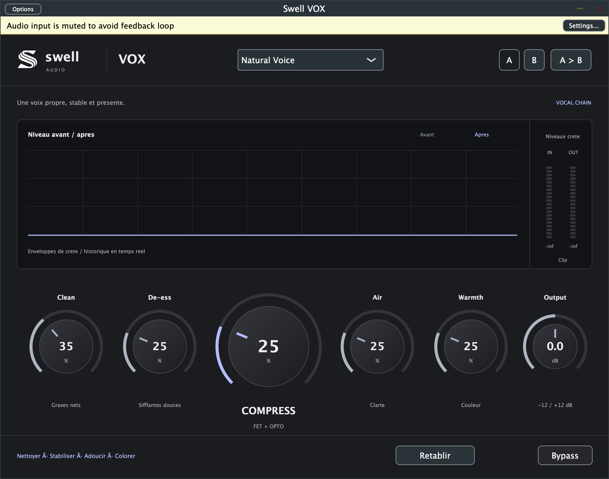

# Swell VOX — prototype 0.1

*Capture de l’application autonome, sans signal audio.*
Chaîne vocale sans menus, dérivée de la base JUCE Swell Vocal Lift.

Clean : atténuation du rumble sous 85 Hz et du bas-médium.
Compress : compression stéréo liée, étage rapide inspiré FET puis lent inspiré Opto, compensation modérée.
De-ess : réduction dynamique de la bande aiguë autour de 5,5 kHz.
Air : couleur aiguë douce.
Warmth : saturation parallèle légère avec suréchantillonnage 4x.
Output : 50 = 0 dB ; plage -12 à +12 dB.
Bypass : comparaison avec latence compensée. Paramètres sauvegardés et automatisables.

Départ conseillé : Clean 35, Compress 25, De-ess 25, Air 25, Warmth 25, Output 50.
Baisser Output si la sortie sature. Pas de limiteur ni de normalisation automatique.
FET/Opto désignent des comportements inspirés, pas des émulations de circuits.
Prototype à valider à l'écoute dans un DAW ; aucun résultat universel garanti.

## Compilation
JUCE 8.0.6, CMake 3.22+, compilateur C++17.
cmake -S . -B build -DCMAKE_BUILD_TYPE=Release
cmake --build build --config Release -j 4
ctest --test-dir build --output-on-failure

Formats : VST3, Standalone et AU sur macOS.
Aucune installation automatique.
Tests DSP : sortie finie, liaison stéréo et neutralité à zéro, à 44,1/48/96 kHz.

## Build macOS vérifié
AU et VST3 compilés pour Apple Silicon (arm64). Signatures ad-hoc vérifiées.
Tests DSP réussis. Chargement dans Logic/FL Studio et validation AU en attente.
Installation utilisateur :
- Swell VOX.component → ~/Library/Audio/Plug-Ins/Components/
- Swell VOX.vst3 → ~/Library/Audio/Plug-Ins/VST3/
Les logiciels hôtes doivent tourner nativement sur Apple Silicon, sans Rosetta.

Version interface v3 : redimensionnement proportionnel de 800 × 584 à 1500 × 1095, poignée dans le coin inférieur droit. AU/VST3 recompilés et signatures vérifiées. Redimensionnement dans les DAW à confirmer.
